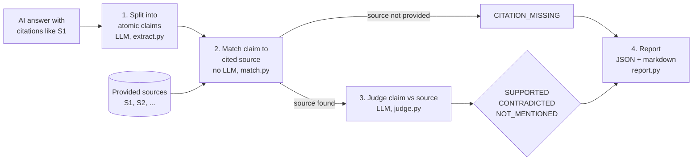

# claimcheck

A tool that checks every claim in an AI answer against its cited source and flags unsupported ones.

> Status: pipeline and evaluation harness are built. The final results on the held-out test split
> are not run yet, so this README reports no scores. See [Results](#results).

## How it works



1. **Split.** An LLM (large language model) turns the answer into one-fact claims and keeps each
   claim's citation marker.
2. **Match.** Plain code looks up the cited source. A citation to a source that was not provided is
   `CITATION_MISSING`, decided without any model call.
3. **Judge.** An LLM reads only the cited excerpt and returns `SUPPORTED`, `CONTRADICTED`, or
   `NOT_MENTIONED` with a quote. The quote is checked against the excerpt, and a quote that is not
   in it is discarded, so the judge cannot invent evidence. The source is fenced as data so text
   inside it cannot give the judge instructions.
4. **Report.** JSON for programs, markdown for people. "Flagged" means any label except `SUPPORTED`.

| Label | Meaning |
|---|---|
| `SUPPORTED` | The cited source states the claim (paraphrase allowed). |
| `CONTRADICTED` | The cited source states something incompatible with the claim. |
| `NOT_MENTIONED` | The cited source neither supports nor contradicts the claim. |
| `CITATION_MISSING` | The answer cites a source that was not provided. |

## Quick start

```bash
python -m venv .venv && source .venv/bin/activate
pip install -e ".[dev]"
pytest
```

Try the pipeline with no API key (scripted stand-ins for the two LLM calls):

```python
import json
from claimcheck.judge import LLMJudge
from claimcheck.llm import ScriptedClient
from claimcheck.pipeline import run_pipeline
from claimcheck.report import to_markdown

answer = "The device was found in 1901. [S1] It has 99 gears. [S2]"
sources = {"S1": "The device was discovered in 1901 in a shipwreck."}

extract = ScriptedClient([json.dumps([
    {"text": "The device was found in 1901.", "citation": "S1"},
    {"text": "The device has 99 gears.", "citation": "S2"}])])
judge = LLMJudge(ScriptedClient([json.dumps({"label": "SUPPORTED",
    "evidence_quote": "discovered in 1901", "rationale": "same year"})]))
print(to_markdown(run_pipeline("demo", answer, sources, extract, judge)))
```

For real calls, install the extra (`pip install -e ".[llm]"`), copy `.env.example` to `.env`, set
`ANTHROPIC_API_KEY`, and wrap `AnthropicClient()` in `CachedClient(client, "claude-haiku-5-5")`
(caches replies and enforces a hard cap on paid calls) in place of each `ScriptedClient`.

## Evaluate a judge

```bash
python -m claimcheck.evaluate --judge baseline --split dev      # free word-overlap baseline
python -m claimcheck.evaluate --judge llm --split dev --yes     # about $0.01, prints estimate first
```

Paid runs print a cost estimate and need `--yes`. The test split is blocked unless `--final` is
passed, so it can only be used once the prompt and settings are frozen. Each run writes
`results/<judge>_<split>.json`, `.md`, and a per-claim `_predictions.csv`.

## Dataset

113 hand-labeled claims from AI answers about 12 questions, each citing two Wikipedia excerpts
(700 words each): 72 organic claims and 41 planted failures. Read [DATASHEET.md](DATASHEET.md)
before trusting any number, and [eval/LABELING_GUIDE.md](eval/LABELING_GUIDE.md) for the rules.
Excerpts are Wikipedia text under CC BY-SA 4.0 (see each file's header).

A finding that needs no judge: the answer-writing chatbot got **13 of 72 organic claims (18%)**
wrong or unsupported by the cited excerpt, 5 of them outright contradictions.

## Results

Not yet. The held-out test split (76 claims, 8 answers) has not been run. When it is, this table
will hold precision, recall, and F1 for the flagged class, the 4-class confusion matrix, and Cohen's
kappa against the hand labels, each with a 95% bootstrap interval, plus the annotator's own
repeatability (kappa between two labeling passes). Organic and planted claims are reported
separately because planted claims are much easier.

| Judge | Slice | Precision | Recall | F1 | kappa |
|---|---|---|---|---|---|
| Claude Haiku 5.5 | organic (test) | pending | pending | pending | pending |
| Word-overlap baseline | organic (test) | pending | pending | pending | pending |

## Limitations

Small dataset, one annotator, one answer-writing model, truncated excerpts ("not mentioned"
means "not in the excerpt"), and Wikipedia text the judge may have memorized. Details are in
[DATASHEET.md](DATASHEET.md).

## Development

```bash
ruff check .
pytest
```

Unit tests mock every LLM call, so they are free and deterministic. CI (continuous
integration) runs lint and tests on Python 3.10 and 3.12.

## License

Code: MIT. Dataset text derived from Wikipedia: CC BY-SA 4.0.
